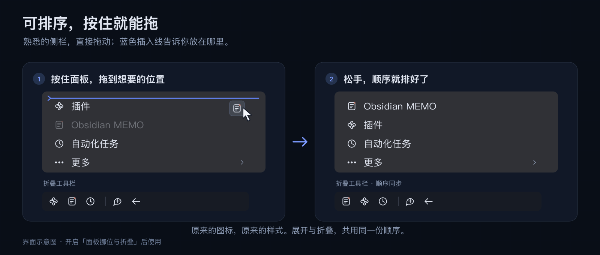
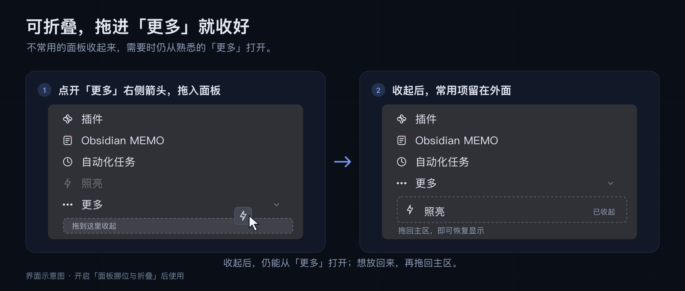

折叠 DSH 左侧栏后，插件、自动化任务等面板图标依然显示在左上角，点击即可打开。

macOS 桌面版 · 零额外依赖 · [安装](#安装)

## 亮点

> 以下为按插件实际行为绘制的界面示意图，不是系统截图。

### 熟悉的入口

沿用左侧面板的图标和顺序，当前面板自动高亮。


### 面板多了，悬停展开

最多平铺 4 个面板；超过时显示前三个和「⌄」。鼠标移到箭头上，即可打开其余面板。


### 拖到底，松手收起

把侧栏拖到最窄，再继续向左拖；指针变成「向左收起」时，松手即可折叠。


### 一键返回会话

在面板中点击「←」回到刚才的会话，回到会话后按钮自动隐藏。v0.4 在展开侧栏顶部收起按钮左侧也放了同样的返回按钮。


### 可排序，按住就能拖

按住面板，拖到想要的位置，松手就排好了。沿用侧栏原有的图标和样式，蓝色插入线提示落点；展开侧栏与折叠工具栏的顺序一起更新。



### 可折叠，拖进「更多」就收好

点开「更多」右侧的 `›`，把不常用的面板拖进去，就能收起。收起后仍能从熟悉的「更多」入口打开，拖回主区就恢复显示。



> 以上两项需在 **插件 → dsh-fold-minimal → 组件开关** 中开启「面板挪位与折叠」（默认关）。开启后，直接在侧栏或折叠工具栏上拖动即可。

### 装上就用，停用即恢复

基础功能无需配置。打开 **插件 → dsh-fold-minimal → 组件开关**，可以分别控制：

- **折叠菜单**（默认开）：折叠工具栏、拖到最窄继续左拖收起、展开与折叠态的返回会话按钮。
- **面板挪位与折叠**（默认关）：拖动排序、收进「更多」与拖回恢复。关闭后恢复默认顺序和显示；保存的偏好保留，下次开启继续使用。

没有额外运行时依赖，也无需构建；关闭对应组件立即移除其拖拽监听，停用插件后恢复原有工具栏和拖拽行为。


## 安装

**需要**：macOS 桌面版 DSH，且左侧栏支持折叠。

### 方式一：在插件页安装（推荐）

1. 打开 **DSH → 插件 → 添加插件**，粘贴仓库地址：

   ```text
   https://github.com/cavenzhong/dsh-fold-minimal
   ```

2. 安装完成后，点击 **立即启用**。
3. 折叠左侧栏，即可使用左上角的面板入口；需要排序与折叠时，到 **插件 → dsh-fold-minimal → 组件开关** 打开「面板挪位与折叠」。

### 方式二：固定版本安装包

在 [Releases](https://github.com/cavenzhong/dsh-fold-minimal/releases) 页使用已有 `.tgz` 安装包的**下载地址**，粘贴到「添加插件」即可锁定版本。各版本是否提供附件以 Release 页面为准。

<details>
<summary>方式三：让 agent 安装</summary>

让 DSH 中的 agent 安装：

```text
plugin_manager install_bundle --target https://github.com/cavenzhong/dsh-fold-minimal
```

</details>

### 停用、更新与卸载

- **停用**：在插件页关闭开关，立即恢复官方折叠态按钮与拖拽行为，不需要重启。
- **更新**：按方式一重新安装仓库版本，或按方式二选择已有 Release 包；更新后停用再启用一次即可加载新版客户端。
- **卸载**：在插件页移除即可；本插件的排序状态只保存在浏览器本地，不写配置文件。

## 使用范围

| 项 | 说明 |
|---|---|
| 系统 | macOS 桌面版（仅 Darwin）；展开态返回按钮、排序拖拽与「更多」二级区都只在 darwin 生效 |
| DSH | 开发与验证环境为 0.2.2-rc.1；需要支持侧栏折叠的版本 |
| 主题 | 跟随 DSH 浅色 / 深色主题，只使用主题 token |
| 面板来源 | 所有 `sidebar.panellist` 注册者，包括未固定的面板 |
| 组件开关 | 插件详情页提供「折叠菜单」（默认开）与「面板挪位与折叠」（默认关）两个开关；状态保存在浏览器本地 |
| 体积 | 无第三方运行时依赖、无构建步骤；`client.js` 约 134 KB（gzip 约 34 KB） |

- 折叠态显示所有已注册的左侧面板，包括未固定的面板；不包含原侧栏「更多」菜单中的其他动作。
- 新装或移除左侧面板插件时，工具栏自动跟随注册表变化，不需要重启。
- 顺序默认与展开态左侧主菜单一致；开启「排序与折叠」后可拖拽自定义，展开态与折叠态同步。
- 窗口极窄时图标仍可能被裁切，可展开侧栏访问。
- 个别插件图标不兼容时，会显示备用图标，但不影响其他入口。
- 工具栏支持 Tab 聚焦、Enter 激活、Esc 关闭「更多」菜单或取消拖拽；排序本身使用指针拖动。
- 4 格上限、拖拽阈值等规则固定，不提供配置项。

<details>
<summary>隐私与安全</summary>

- **Host 半为空**：`index.js` 不注册服务、工具或提示词；所有逻辑只在浏览器端运行。
- **只存布局偏好**：开启「排序与折叠」后，顺序与收起项保存在本机 cookie（主存储，跨 DSH 启动的本地端口）并镜像到同源 `localStorage`；不联网、不读取文件、不上传任何内容。
- **最小侵入**：只读面板注册表与布局状态；除用户操作触发的切换面板、折叠侧栏、返回会话、排序/收起面板，以及工具栏的标题让位外，不修改宿主状态。
- **埋点沿用宿主能力**：点击官方面板（插件 / 自动化任务）或新建会话时，调用 DSH 自带的 `productAnalytics`，与官方按钮同一口径；插件不上报会话内容。
- **停用即清理**：样式、监听、注入的 chrome 和槽位注册随停用移除，立刻回到官方行为。
- **可审计**：`client.js` 单文件手写、无构建、无第三方依赖，MIT 许可。

</details>

## 常见问题

<details>
<summary>折叠后左上角没有出现面板图标？</summary>

确认三件事：是 macOS 桌面版 DSH；插件已启用；左侧栏至少注册了一个面板。窗口极窄时图标也可能被裁切，可以先把窗口拉宽或展开侧栏检查。
</details>

<details>
<summary>第 5 个面板的入口去哪了？</summary>

面板区固定 4 格。第 5 个面板出现时，第 4 格变成「⌄」，被挤出的面板都在悬停菜单里；悬停、点击或键盘都能打开，Esc 关闭。
</details>

<details>
<summary>为什么只平铺 4 格？</summary>

折叠态工具栏和会话标题共用窗口左上角，固定格数让工具栏宽度有上限，不随面板数无限增长；溢出的面板仍可通过「⌄」打开。
</details>

<details>
<summary>怎么开启排序与折叠？</summary>

**插件 → dsh-fold-minimal → 组件开关 → 面板挪位与折叠**。打开后，按住侧栏面板行拖动即可排序（拖动时不跳动，用蓝色插入线提示落点）；「更多」行右侧会出现 `›`，点开后可以把面板拖进二级区收起。同一页还可以单独关掉原有的「折叠菜单」。
</details>

<details>
<summary>排序/收起状态存在哪里？清掉会怎样？</summary>

两个开关、顺序和收起项保存在本机浏览器（cookie 主存储 + 同源 localStorage 镜像），跟着这台机器上的 DSH 页面。清除 cookie/站点数据会回到默认偏好；存储不可用时，本次使用仍可在内存中调整。插件不写 DSH 配置文件。
</details>

<details>
<summary>图标变成了备用图标？</summary>

个别插件的图标依赖额外的宿主上下文，本插件会退化为通用图标，但不影响其他入口，也不会让工具栏报错。
</details>

<details>
<summary>拖到最窄，松手却没有折叠？</summary>

需要先拖到宿主允许的最小宽度，再继续向左拖约 80px；指针变成「向左收起」时再松手。只对左侧栏手柄和 macOS 生效。
</details>

<details>
<summary>「←」返回按钮不出现？</summary>

它只在主区域停留于全局面板时出现；回到会话后自动隐藏。展开侧栏的返回按钮同样遵循这个规则。
</details>

<details>
<summary>DSH 升级后失效了？</summary>

插件只依赖公开的插槽与布局接口，不 import 任何 DSH Client 包；展开态的 DOM 增强依赖 `data-sidebar-toggle` 等宿主标记。若宿主改动了这些结构，可能退化或失效；在插件页停用即可回到官方按钮，也欢迎[反馈](https://github.com/cavenzhong/dsh-fold-minimal/issues)。
</details>

## 反馈与贡献

- 遇到问题或想改行为，欢迎提 [Issue](https://github.com/cavenzhong/dsh-fold-minimal/issues)。请附上 DSH 版本、插件版本、左侧面板列表，以及期望结果和实际结果。
- 代码很小，也欢迎直接提 PR；改完后跑一遍 `pnpm test`。
- 如果它让你的折叠侧栏更顺手，欢迎 Star。

<details>
<summary>实现与开发</summary>

通过 DSH 现有插槽和布局接口提供工具栏，复用已注册的面板图标。面板排序使用公开的「同 id、更低 priority 影子注册」改写 order，不改宿主源码、不替换侧栏组件；展开态的返回按钮、`›` 与二级区是对宿主已渲染 DOM 的增量增强。客户端只使用平台基座的 React（二级区通过 `react-dom` portal 渲染）；Host 入口为空，无需构建。

本地开发时，在 DSH 中安装仓库目录：

```text
plugin_manager install_bundle --target link:/path/to/dsh-fold-minimal
```

修改 `client.js` 后，停用再启用插件即可加载。运行测试：

```bash
pnpm test
```

40 项测试覆盖面板顺序、组件开关、拖拽与取消、存储降级和卸载清理。CI 在 push 到 `main` 和 PR 时用 Node 22 / 24 运行相同测试，无需安装依赖。完整说明见 [技术文档](docs/TECHNICAL.md)，本轮结构与性能排查见 [0.4.3 排查记录](docs/CODE_REVIEW.md)。

</details>

<details>
<summary>更新记录</summary>

- **v0.4.3 · 2026-11-09**：拖拽测量按帧合并；相同布局不重复通知或写存储；关闭排序组件时回收监听与提示节点；修复停用 / 失焦后的延迟折叠与存储受限回退，清理旧预览等冗余路径。
- **v0.4.2 · 2026-11-09**：修复「更多」二级列表与悬浮菜单的显示和互斥；拖动采用原生箭头与插入线。折叠工具栏拖动时平铺全部面板，以分隔线和浅色文字区分显示区与隐藏区，支持跨区拖放及区内排序；浅灰虚线只保留在「更多」下方区域。
- **v0.4.0 · 2026-11-09**：插件详情页新增 2 个组件开关（折叠菜单 / 面板挪位与折叠）；展开态新增返回按钮（收起按钮左侧）；「面板挪位与折叠」支持展开/折叠两处拖拽排序、共用一套顺序，面板可拖进「更多」第二级并拖回恢复；排序与显隐状态保存在浏览器本地。
- **v0.3.0 · 2026-11-05**：面板区固定 4 格，溢出面板收进悬停「更多」菜单；侧栏拖到最小后继续左拖，松手即收起。
- **v0.2.0 · 2026-11-05**：新增返回会话按钮，提供 Release 安装包。
- **v0.1.0 · 2026-11-04**：折叠态显示左侧面板图标，支持顺序与选中态同步。

完整版本与安装包见 [Releases](https://github.com/cavenzhong/dsh-fold-minimal/releases)。

</details>

[MIT](LICENSE) © cavenzhong

> 本项目是第三方插件，与 DeepSeek 官方无关。
