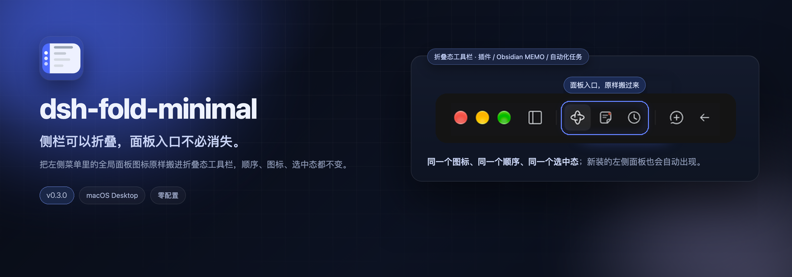
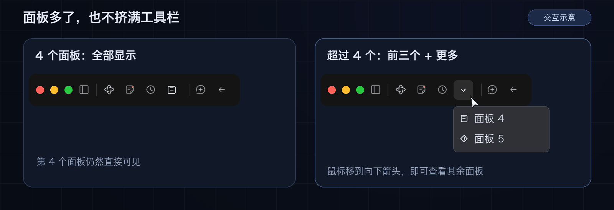
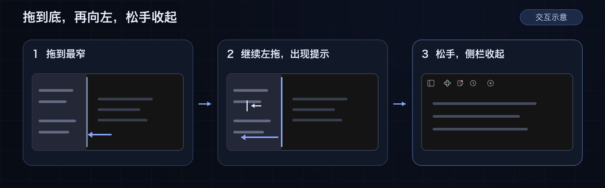

折叠 DSH 左侧栏后，插件、自动化任务等面板图标依然显示在左上角，点击即可打开。

macOS 桌面版 · 无需配置 · [安装](#安装)

## 亮点

### 熟悉的入口

沿用左侧面板的图标和顺序，当前面板自动高亮。


### 面板多了，悬停展开

最多平铺 4 个面板；超过时显示前三个和「⌄」。鼠标移到箭头上，即可打开其余面板。



### 拖到底，松手收起

把侧栏拖到最窄，再继续向左拖；指针变成「向左收起」时，松手即可折叠。



### 一键返回会话

在面板中点击「←」回到刚才的会话，回到会话后按钮自动隐藏。


### 装上就用，停用即恢复

无需配置，没有额外运行时依赖；停用后恢复原有工具栏和拖拽行为。


## 安装

1. 打开 **DSH → 插件 → 添加插件**，粘贴仓库地址：

   ```text
   https://github.com/cavenzhong/dsh-fold-minimal
   ```

2. 安装完成后，点击 **立即启用**。
3. 折叠左侧栏，即可使用左上角的面板入口。

<details>
<summary>让 agent 安装</summary>

让 DSH 中的 agent 安装：

```text
plugin_manager install_bundle --target https://github.com/cavenzhong/dsh-fold-minimal
```

</details>

## 使用范围

- 适用于支持侧栏折叠的 **macOS 桌面版 DSH**。
- 显示所有已注册的左侧面板，包括未固定的面板；不包含原侧栏「更多」菜单中的其他动作。
- 窗口极窄时图标仍可能被裁切，可展开侧栏访问。
- 个别插件图标不兼容时，会显示备用图标。

<details>
<summary>实现与开发</summary>

通过 DSH 现有插槽和布局接口提供工具栏，复用已注册的面板图标。客户端只使用宿主 React；Host 入口为空，无需构建。

本地开发时，在 DSH 中安装仓库目录：

```text
plugin_manager install_bundle --target link:/path/to/dsh-fold-minimal
```

修改 `client.js` 后，停用再启用插件即可加载。运行测试：

```bash
pnpm test
```

完整说明见 [技术文档](docs/TECHNICAL.md)。

</details>

<details>
<summary>更新记录</summary>

- **v0.3.0 · 2026-11-05**：面板区固定 4 格，溢出面板收进悬停「更多」菜单；侧栏拖到最小后继续左拖，松手即收起。
- **v0.2.0 · 2026-11-05**：新增返回会话按钮，提供 Release 安装包。
- **v0.1.0 · 2026-11-04**：折叠态显示左侧面板图标，支持顺序与选中态同步。

</details>

[MIT](LICENSE) © cavenzhong
