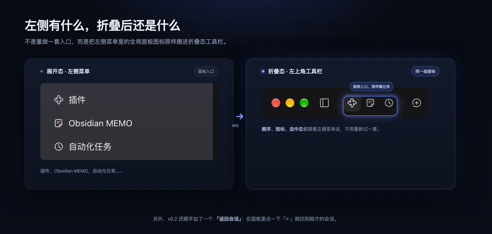
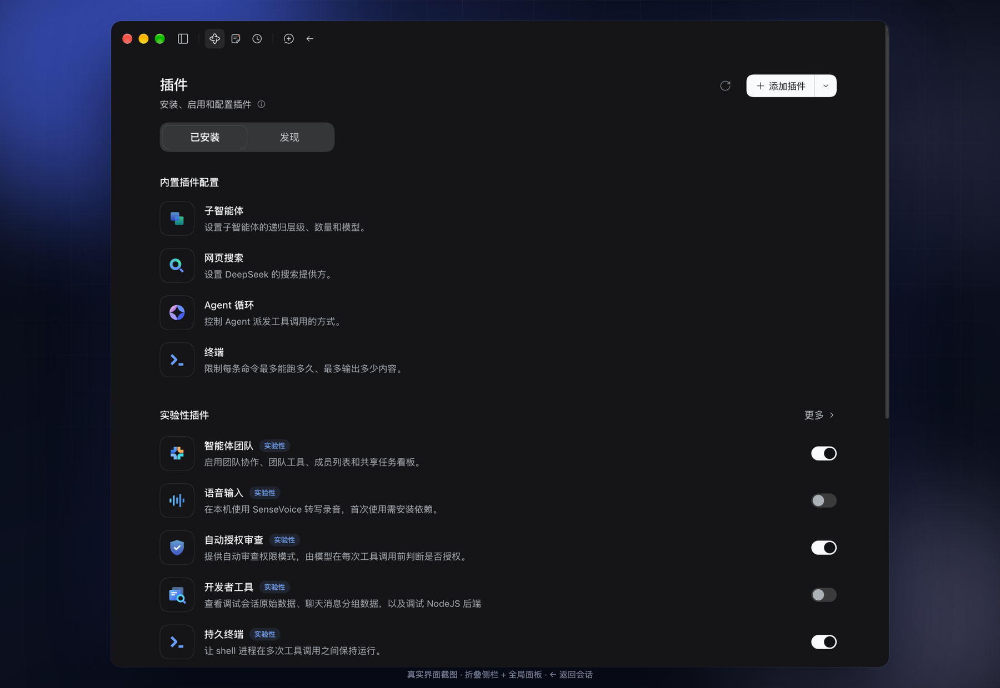
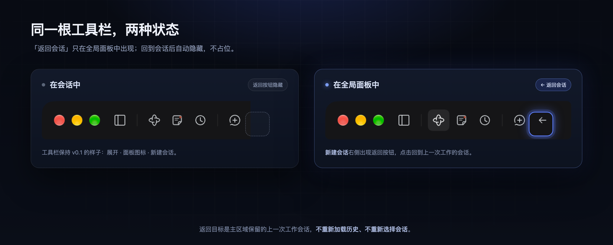

<p align="center">
  
</p>

<p align="center">
  
  
  
</p>

<p align="center">
  <b>侧栏可以折叠，面板入口不必消失。</b><br>
  <sub>把左侧菜单里的全局面板图标原样搬进折叠态工具栏。同一个图标、同一个顺序、同一个选中态。</sub>
</p>

---

## 它真正解决的问题

DSH 折叠左侧栏后，左上角只剩「展开」和「新建会话」。插件、自动化任务、Obsidian MEMO 这些全局面板入口，全都留在展开态。

想用面板，得先展开；切回会话，又得再展开。两步不多，但足够打断一次心流。

**dsh-fold-minimal 把左侧菜单里的全局面板图标直接搬进折叠态工具栏。**

不是重做一套入口，而是同一个图标、同一个顺序、同一个选中态。折叠侧栏之后，你依然可以一键切面板。

<p align="center">
  
</p>

<p align="center">
  <sub>左侧有什么，折叠后还是什么。</sub>
</p>

## 真实界面

<p align="center">
  
</p>

<p align="center">
  <sub>折叠侧栏 + Plugins 面板。左上角工具栏里是左侧菜单的面板图标；最右边的小箭头，是 v0.2 顺手加的「返回会话」。</sub>
</p>

## 轻量，不打扰

它不试图替代 DSH 的侧栏，也不重排你的工作区。折叠时，它只是把左侧那一列面板入口，换成左上角的一行图标。

- 不新增侧栏、不新增设置页、不新增快捷键。
- 只在 macOS 桌面折叠态出现；展开态保持 DSH 原样。
- 只多一行图标；当前面板的选中态跟着左侧菜单走。
- 停用 / 卸载立刻回退官方按钮，不需要重启。

## 顺手的小心思：返回会话

v0.2 在全局面板里加了一个小按钮：**新建会话**右侧出现 **←**，点一下回到刚才的会话；回到会话后它自动隐藏。

它不是这个插件的重点。只是既然「切面板」已经变简单了，就把「从面板回会话」也少一步。

<p align="center">
  
</p>

<p align="center">
  <sub>同一根工具栏，两种状态。返回按钮只在全局面板中出现。</sub>
</p>

## 功能一览

| | |
|---|---|
| 🧩 **面板入口一个不少** | 插件、自动化任务、Obsidian MEMO……新装的左侧面板会自动出现在折叠态工具栏。 |
| ↕️ **顺序就是左侧顺序** | 与展开态左侧主菜单完全一致。 |
| 🔵 **选中态同步** | 当前面板的图标会显示选中底色，点击即切面板。 |
| 🪶 **轻量** | 只多一行图标，不改展开态，不改变 DSH 的任何默认行为。 |

## 安装

**需要**：macOS 桌面版 DSH（左侧栏支持折叠）。

1. 克隆仓库：

```bash
git clone https://github.com/cavenzhong/dsh-fold-minimal.git
```

2. 在 DSH 里用 `plugin_manager` 安装（把路径换成你的克隆位置）：

```bash
plugin_manager install_bundle --target link:/path/to/dsh-fold-minimal
```

3. 折叠左侧栏，效果立刻出现。

> 开发时改完 `client.js`，在插件页把本插件**停用再启用**一次即可加载新版本。

## 使用

1. 折叠左侧栏。
2. 左上角出现 **展开 │ 面板图标 │ 新建会话** 工具栏。
3. 点任意面板图标，直接切换面板；当前面板的图标会高亮。
4. 在全局面板里，**新建会话**右侧还会出现 **←**；点击回到刚才的会话。

## 兼容与边界

- 只影响 macOS 桌面的折叠态；展开态、Windows / Linux 的窄侧栏轨道保持原样。
- 折叠态显示所有已注册的 `sidebar.panellist` 面板（包含未固定的条目）；「更多」菜单里的动作不在折叠态提供。
- 返回目标是主区域保留的上一次工作会话（空白新会话草稿也算），不做「最近会话」排序。
- 面板很多或窗口很窄时，工具栏不横向滚动，超出部分会被窗口裁掉。
- 某个插件的图标不兼容时，会退化成兜底图标，不影响整条工具栏。

## 更新记录

### v0.2.0 · 2026-11-05

- 新增「返回会话」小按钮：在全局面板中出现，点击回到上一次工作的会话；已在会话中时隐藏。

### v0.1.0 · 2026-11-04

- 折叠态工具栏按左侧菜单顺序映射全局面板图标。
- 选中态同步、标题让位、插件图标自动跟随。

<details>
<summary>技术细节 / 开发</summary>

- 浏览器半只 require 平台基座里的 `react`，不 import 任何 DSH Client 包。
- 面板图标读 `sidebar.panellist` 注册者，直接渲染插件自己的图标组件。
- 「返回会话」调用布局层原生 `ctx.layout.selectPanel(null)`；主会话由 `uiWorkspace` 的 `mainView` 引用保留，不需要重新加载。
- 完整实现说明与测试：[docs/TECHNICAL.md](docs/TECHNICAL.md)。

</details>

## License

MIT © cavenzhong
